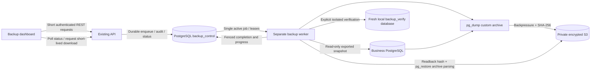

# Native backup system: audit, implementation and operations

Date: 16 November 2026. Scope: `Accounts/rgaccountbackend` and `Accounts/rgaccount` (`/settings/backups`). No production database, cloud bucket, deployed service or existing backup was changed during implementation or testing.

## Evidence and diagnosis

The previous click path was `BackupSettings.jsx` → `POST /backups/exports` → `createBackupExportJobs()` → `exportBackupSet()` → `exportBackup()` → a temporary archive directory → authenticated download. Initiation was already asynchronous from the HTTP response, but its task ran inside the API's Node process. The in-memory `Map` in `backupExportJobs.js` was its queue and history. Restarting the API lost ownership/status, and its duplicate guard applied only to that process.

The main scaling defect is in `backup.service.js:readTables`: a cursor fetches 5,000 rows at a time, then appends **every row** to `tables[].rows`. Cursor fetch size therefore does not bound retained memory. The whole dataset remains alive during attachment discovery, validation, canonical serialization, checksumming and compression. `backupArchive.js` streams canonical JSON tokens into gzip, but still retains the original rows and collects the entire compressed result in a `Buffer`. Attachment multipart output improves individual file limits; it does not fix the all-records array. `backupExportJobs.js` subsequently writes each complete buffer to temporary disk.

This work occupied the API's event loop, heap, and a client from its normal pool. The app pool defaults to 10 connections (maximum 20), with up to 64 waiting checkouts. It was not an unbounded `Promise.all()` extraction; the demonstrated causes are retained data and CPU/serialization sharing the API process. A repeatable-read, read-only transaction and relation locks already protected database extraction. The old JSON format required a matching installed schema for restore; it was not a full native schema-reconstruction archive. Original files were gathered after references were read, so mutable/deleted file storage was never made transactional by the database snapshot.

`GET /backups/catalog` used exact counts across all tables. The new dashboard does not call it. Existing small-archive legacy imports remain explicitly opt-in behind maintenance mode; the old generation endpoints now return 410.

The configured environment was inspected without printing secrets: database provider hint **Neon**, `DB_SSL=true`, S3 configured in **us-east-1**, no Redis URL, no backup-specific settings. Repository documentation identifies the hosted API as Render. No app-specific infrastructure manifest, actual Render memory/CPU quota, billing plan, backup OOM trace, or production latency recording was available. The old `.env.example` itself warned that archives were processed in memory and suggested a memory budget several times their expanded limit. The exact production crash event cannot be attributed to a measured allocation or hosting quota without those logs. The controlled benchmarks below establish the memory scaling defect; they do not reconstruct the reported production crash.

## Selected architecture



PostgreSQL is already essential to this application. A durable SQL job table and one independent worker avoid a new managed queue service. Jobs do not extract data in HTTP handlers. The worker holds a session advisory lock, uses an independent pool, and runs `pg_dump` as an operating-system child with streamed stdout. At default multipart settings, S3 part buffering is approximately `8 MiB × 2` plus stream, SDK/TLS, native process and runtime overhead; this is a design bound for transfer buffers, **not a guarantee that total RSS equals 16 MiB**. One database snapshot connection and one `pg_dump` connection are separate from the API pool.

| Technology | Decision and reason |
| --- | --- |
| PostgreSQL durable queue | Selected: transactional status/audit, uniqueness, leases, retry and existing infrastructure. |
| BullMQ / Redis | Already installed for another optional module, but Redis is unconfigured. Not used here: one global backup slot does not justify another durable service. Reconsider when independent queue throughput warrants it. |
| Kafka | Not selected; there is no event-streaming requirement. |
| GraphQL | Existing REST supports this job workflow; no additional transport is needed. |
| Zod | Not added solely for a few constrained inputs. Existing explicit validation and database checks cover scope, UUIDs, confirmation, progress and configuration. |
| Worker threads | Insufficient deployment/resource isolation for this workload; a separate managed process is selected. |
| `pg_dump` / `pg_restore` | Selected: native schema/data formats and consistent snapshot support; avoids JavaScript row exports. |
| S3 multipart | Selected: existing AWS SDK, bounded upload concurrency, private encryption and abort behavior. |
| Polling | Selected: small durable status responses, 3-second active polling in the UI; no percent/ETA invented. |
| Managed PITR / snapshots | Complementary and necessary when recovery-point objectives are shorter than dump frequency; provider configuration remains an operations task. |

PostgreSQL documents that `pg_dump` creates consistent database exports and that cluster roles/tablespaces require separate protection. It is a logical export, not WAL-based point-in-time recovery. See [PostgreSQL pg_dump](https://www.postgresql.org/docs/18/app-pgdump.html) and [backup approaches](https://www.postgresql.org/docs/18/backup.html). The configured Neon provider supports [branching and restoration](https://neon.com/docs/introduction/branching); the actual project plan/history window was not queried or changed.

## Implemented code and metadata

| Area | Files |
| --- | --- |
| Durable schema | `src/migrations/249_native_backups.js` |
| Job lifecycle / audit | `src/services/nativeBackupJobs.js` |
| REST / legacy endpoint retirement | `src/routes/nativeBackup.routes.js`, `src/routes/backup.routes.js` |
| Configuration / credential isolation | `src/services/nativeBackupConfig.js` |
| Native subprocess lifecycle | `src/services/nativeBackupProcess.js` |
| Dump / archive verification / isolated restore | `src/services/nativeBackupEngine.js` |
| S3 multipart, checksum, download, cleanup | `src/services/nativeBackupStorage.js` |
| Managed attachment capture / file index / recovery | `src/services/nativeBackupFiles.js`, `src/services/nativeBackupRecovery.js`, `scripts/recover-native-files.mjs` |
| Independent worker | `src/workers/backupWorker.js` |
| Frontend | `../rgaccount/src/components/settings/BackupSettings.jsx` and associated backup client/tests |
| Reproducible evidence | `scripts/bench/backup-legacy.bench.mjs`, `scripts/benchmark-native-backup.mjs`, `test/native-backup*.test.mjs`, `benchmarks/backup-*.json` |

`backup_control` is excluded from the native dump so restoring business data cannot resurrect runnable queue jobs.

- `jobs`: UUID, actor, kind, scope, optional source backup, state/stage, attempt limits, scheduling/heartbeat/lease timestamps and fencing token, cancellation, measured bytes, checksum, verification state, safe error, artifact keys, metadata, expiry and timestamps.
- `attempts`: immutable per-attempt prefix/token, lifecycle, error and cleanup timestamp. Each retry receives a new artifact prefix and starts a fresh dump.
- `events`: creation, start, cancel, retry, download authorization, verification, cleanup and retention transitions. The event and associated state transition commit together.
- `files`: durable per-attempt deduplication and bounded file-index pagination, including original locator/version and copied artifact hash/size.
- Partial unique index on a constant for `queued`/`running` enforces one active backup or restore verification across API instances. History and expiry indexes bound dashboard/retention reads.

States are `queued`, `running`, `completed`, `failed`, `cancelled`, `deleting`, `expired`. `FOR UPDATE SKIP LOCKED` claims work. Database time owns lease validity; a stale worker cannot complete an expired/new attempt. Heartbeats run at most five seconds apart. The default lease is 90 seconds, maximum attempts three, exponential retry delay begins at five seconds, and attempts time out after six hours. SIGTERM/SIGINT cancel subprocess/upload work; SIGKILL recovery follows lease expiry. Native process termination escalates to SIGKILL after five seconds.

The worker publishes success only after dump exit success, archive SHA-256 readback and parsing, every required managed file verification, file index verification, and final manifest verification. The retention timestamp is **deletion eligibility**, not automatic expiry: a completed retained archive remains downloadable after that date. Deletion first reserves an eligible backup and requires a newer verified backup of the same scope, or a `database-files` backup that covers a `database` backup. A newer database-only archive cannot replace the last backup containing originals. Cleanup errors remain retryable and logged with safe codes. Restore verification does not automatically retry a partially restored target.

The global advisory lock `(734921, 1)` is a second serialization guard shared with legacy restore. Stop the native backup worker before an exceptional legacy import; even an idle worker holds this session lock. Keep all API instances in maintenance mode and stop every other writer as the legacy restore procedure requires. A second worker exits in standby; use one desired worker instance with process supervision. Short overlap during deployments is safe. A network partition can temporarily leave an old native process alive until connection/error/heartbeat detection; fencing prevents it publishing success. Its attempt-specific artifacts cannot overwrite a new attempt.

## API and dashboard

All paths are relative to the application's existing `/backups` mount and retain its authentication/backup-admin guard. Authorization is checked against the database, not solely stale JWT role claims. Response/cache protections are inherited from the backup guard.

| Endpoint | Behavior |
| --- | --- |
| `GET /jobs` | Latest 50 durable jobs, retention, storage, feature/restore availability. |
| `POST /jobs` | `{ "scope": "database" }` or allowed `database-files`; returns 202 with job ID. Duplicate active jobs return 409. |
| `GET /jobs/:id` | Durable status, stage, measured bytes and timestamps. |
| `POST /jobs/:id/cancel` | Cancel queued work immediately or request cancellation on next heartbeat. |
| `POST /jobs/:id/retry` | New attempt for failed/cancelled database backup; privileged restore retry must use the protected restore action. |
| `POST /jobs/:id/download` | Authorizes and audits a 60-second signed link for database, manifest, file index or an identified captured file. |
| `POST /jobs/:id/restore-test` | Elevated restore guard and exact `VERIFY RESTORE` confirmation; target is server-configured, never client-supplied. |

The dashboard has start, history, cancel/retry, download and isolated restore verification controls. History survives refresh. It displays actual stage/bytes/elapsed time and retains data while network requests reconnect. No body containing the database is fetched into browser memory. The export remains database-wide, including all sites/organizations; existing backup-admin access is therefore deliberately broad and should be granted sparingly.

## Attachment consistency and recovery

Database-only mode is available by default and clearly identifies that original file bytes need separate protection. Full file capture requires `BACKUP_FILES_POLICY=immutable-retained`. This is an **operator-established storage guarantee**, not a property this code can enforce for every writer:

1. Once referenced, a local/S3 key is immutable. Replacement creates a new key.
2. Deletion is delayed beyond the maximum job duration plus retry/recovery margin.
3. S3 versioning, backup retention and access controls protect historical originals. The worker records returned source version IDs, but current references do not contain transactional version IDs, so versioning alone does not make overwrites safe.
4. Local uploads are mounted read-only at the worker's `BACKUP_LOCAL_ROOT`, with the same relative paths as the API. An isolated host without this volume cannot capture local originals.

A shared exported PostgreSQL snapshot anchors database records and attachment reference scanning. Rows are fetched one at a time with an expanded JSON row bound, duplicates are indexed in `backup_control.files`, and each original streams to a separate encrypted object. Missing files, changed local file stats, oversized scan rows and failed checksums fail the whole attempt. External URLs such as Cloudinary retain links only and require provider-specific protection. Database-only backups remain usable when a single row exceeds the file scanner's 1 MiB bound.

For recovery, retrieve `manifest.json`, `files.ndjson`, `database.dump`, and every listed managed-file artifact through authorized tools. Verify their SHA-256/byte counts. Copy originals to a **new isolated bucket/prefix or local volume**, preserving locators or deliberately rewriting references in the isolated database. Validate all references and application reads before cutover. The built-in restore verifier restores the database. The separate operator command below verifies manifest, file index and each artifact, then recovers files into a **new** private staging directory:

```sh
node scripts/recover-native-files.mjs JOB_UUID /private/recovery/NEW_DIRECTORY
```

The inventory is verified before recovery and hashed again during the actual recovery read; a changed index prevents the verified marker. The destination must not exist. Its layout is `local/<original-key>` and `s3/<original-bucket>/<original-key>`. `RECOVERY_INCOMPLETE` remains on failure; a successful run replaces it with `RECOVERY_VERIFIED.json`. This command audits start/success/failure and does not overwrite or publish original S3/local paths. After reference checks, explicitly plan the storage cutover. Never overwrite current S3 objects during an automated restore test.

## Reproducible measured results

`benchmarks/backup-legacy.json` records the original engine over PGlite at 16/64 MiB before refactoring. PGlite reserves substantial memory in-process, so that report's absolute RSS is not used for before/after claims. `benchmarks/backup-native.json` compares the same legacy export and new native engine over **identical disposable native PostgreSQL 18.4 fixtures**. These are single samples on this development machine, not a production benchmark or SLA. Values below are from that artifact; 1 MiB = 1,048,576 bytes.

| Logical fixture | Engine | Duration | Peak Node RSS | Peak Node heap | Event-loop maximum |
| --- | --- | ---: | ---: | ---: | ---: |
| 16 MiB | Legacy buffered JSON | 100.05 ms | 159.45 MiB | 50.80 MiB | 31.62 ms |
| 16 MiB | Native compression 1 | 87.45 ms | 82.06 MiB | 12.71 MiB | 11.30 ms |
| 64 MiB | Legacy buffered JSON | 348.81 ms | 303.86 MiB | 133.06 MiB | 78.05 ms |
| 64 MiB | Native compression 1 | 134.07 ms | 82.58 MiB | 12.95 MiB | 10.67 ms |
| 64 MiB | Native compression 3 | 136.88 ms | 83.31 MiB | 12.95 MiB | 11.58 ms |
| 1 GiB | Native compression 1 | 1,256.40 ms | 92.47 MiB | 13.57 MiB | 11.17 ms |

A later native-only run, `benchmarks/backup-native-large.json`, uses the same synthetic source at 5/10 GiB with a **192 MiB V8 heap cap** (the earlier comparison used 1024 MiB). Both completed archive parsing and checksum readback through the filesystem adapter.

| Logical database fixture | Archive bytes | Duration | Peak Node RSS (lifetime) | Event-loop maximum | Concurrent indexed-read p95 / p99 |
| --- | ---: | ---: | ---: | ---: | --- |
| 5 GiB | 70,302,997 | 6,264.76 ms | 93.34 MiB | 11.16 ms | 0.18 / 0.39 ms (612 samples) |
| 10 GiB | 140,609,751 | 12,500.05 ms | 92.81 MiB | 13.66 ms | 0.18 / 0.29 ms (1,221 samples) |

The source uses 4 KiB strings formed by repeating a per-row MD5. It is highly compressible: the 1 GiB logical fixture produced a 14,061,511-byte archive. It does **not** represent 1 GiB of encrypted attachments, physical database size, or an incompressible S3 transfer. Native measurements include streamed filesystem output, full hash readback and archive parsing; legacy measurements return an archive buffer. Node CPU excludes `pg_dump` and database CPU. The fixture server had `shared_buffers=64MB`, 12 connections and fsync disabled because it was disposable. S3's actual multipart buffers add overhead not measured by the filesystem adapter.

`benchmarks/backup-api.json` adds a separate local HTTP measurement using the real Express backup router, PostgreSQL queue/audit transitions and live database role checks. Synthetic identity middleware replaces JWT/session authentication. After three warmups, 20 `POST /jobs` responses had p95 **1.125 ms**, p99/max **1.392 ms**, all below the 500 ms design target in this fixture. `GET /jobs` p95 was 0.591 ms idle (20 samples) and 1.116 ms during a separate actual backup worker run (28 samples). That worker dumped/verified a synthetic 64 MiB database into an 882,154-byte archive. This uses loopback, fsync off, pools of three and local streaming storage; authentication overhead, normal application middleware/proxies, real user load, remote latency and S3 are excluded. With only 20 samples, p99 is the observed maximum. These timings are not a production SLA.

At 64 MiB, concurrent indexed-read p95/p99 were 12.57/14.43 ms for legacy (25 samples), 2.15/2.15 ms for native (13 samples). For 1 GiB native, they were 0.19/0.36 ms (123 samples). These are loopback PostgreSQL reads, **not HTTP application API p95/p99**, and the small sample counts do not support an availability guarantee. Compression levels 1 and 3 had effectively identical archive sizes for this fixture; level 1 is the provisional low-CPU default, pending representative media and production I/O measurements.

`benchmarks/backup-multipart.json` separately measures the **actual installed AWS SDK `Upload` implementation** through `nativeBackupStorage`, using generated 64 KiB chunks and a fake S3 client that discards bounded multipart buffers. Each size runs in a fresh Node process with a 192 MiB V8 heap cap. No database, compression, file writes, network requests or real S3 service participates.

| Generated transport bytes | Peak Node RSS | Peak Node heap | Duration | Largest part / simultaneous parts | Temporary disk |
| --- | ---: | ---: | ---: | --- | ---: |
| 1 GiB | 213.59 MiB | 16.01 MiB | 503.38 ms | 8 MiB / 2 | 0 |
| 5 GiB | 232.41 MiB | 16.26 MiB | 2,110.94 ms | 8 MiB / 2 | 0 |
| 10 GiB | 316.86 MiB | 16.23 MiB | 4,070.99 ms | 8 MiB / 2 | 0 |

This is allocation/backpressure scaling evidence for the SDK path, **not a 10 GiB database-backup or cloud-throughput result**. RSS includes garbage-collected SDK/native buffers and grew across these samples; it is materially above the nominal 16 MiB of simultaneous parts. The 1/5/10 GiB logical database experiments and the 1/5/10 GiB transport experiment answer different questions and must not be combined into a production capacity claim.

The real engine integration test restored a native archive into a newly created PostgreSQL database under an unprivileged owner. `benchmarks/backup-restore.json` records its measured backup/restore durations. It validated precision, enum, foreign key, trigger/function, next sequence value, index, view, exclusion of queue schema, original file bytes and actual recovery into a fresh private staging directory, archive/manifest/file-index SHA-256, and rejection of unsafe/nonempty targets, a corrupt archive and an oversized compressed row. This demonstrates the fixture's recoverability, not a full production disaster-recovery rehearsal.

The final combined backend regression run passed **116/116 tests, zero failures and zero skips**, in **13,440.56 ms**. Its complete output is saved in `benchmarks/backup-validation.txt`. This run includes legacy compatibility, real native PostgreSQL backup/restore, queue/API/worker failure paths, multipart upload and file-recovery checks. The backup-related frontend checks passed **37/37 tests**, with its production build and changed-file lint checks passing. Desktop/mobile review artifacts are in `../output/backup-system/ui/dashboard-desktop.png` and `dashboard-mobile.png`. These are development validation results; the production deployment remains unexecuted.

Frontend interaction tests accept an external compatible React test-renderer module through `REACT_TEST_RENDERER_MODULE`. This run reused the existing `/private/tmp/commission-react-test-runtime/node_modules/react-test-renderer/index.js`; that location is ephemeral and no production dependency was added. A fresh development/CI environment must provide a compatible renderer and set its path, otherwise those opt-in interaction cases skip. From the frontend directory:

```sh
REACT_TEST_RENDERER_MODULE=/absolute/path/to/compatible/react-test-renderer/index.js npm run test:backups
npm run build
```

Commands from the backend directory:

```sh
npm run test:native-backup
npm run test:backup
npm run benchmark:backup:legacy
node scripts/benchmark-backup-multipart.mjs
# Set these only to an isolated local disposable *_test database.
BACKUP_NATIVE_TEST_DATABASE_URL=postgresql://test_owner@127.0.0.1:55439/backup_engine_test \
BACKUP_PG_DUMP=/path/to/pg_dump BACKUP_PG_RESTORE=/path/to/pg_restore \
node --test test/native-backup-integration.test.mjs
BACKUP_NATIVE_TEST_DATABASE_URL=postgresql://test_owner@127.0.0.1:55439/backup_engine_test \
BACKUP_PG_DUMP=/path/to/pg_dump BACKUP_PG_RESTORE=/path/to/pg_restore \
node scripts/benchmark-native-backup.mjs --sizes=16,64,1024
# Optional larger highly compressible logical database fixtures, separate report:
BACKUP_NATIVE_TEST_DATABASE_URL=postgresql://test_owner@127.0.0.1:55439/backup_engine_test \
BACKUP_PG_DUMP=/path/to/pg_dump BACKUP_PG_RESTORE=/path/to/pg_restore \
node scripts/benchmark-native-backup.mjs --sizes=5120,10240 --report=backup-native-large.json
```

Native integration tests deliberately skip without an explicit local test URL. Queue/worker native tests use their own isolated test databases so parallel tests cannot compete for the global backup slot. Further controlled staging runs should cover 1/5/10 GiB of representative data, slow uploads, region latency and concurrent ERP reads/writes. Measure worker **and native child** RSS/CPU, database I/O, temporary disk, archive/restore time, p95/p99 HTTP latency and daily transfer volume. Highly compressible 1/5/10 GiB logical database fixtures and generated SDK transport streams were measured as described above. Representative business/media datasets, real cloud throughput, and production HTTP p95/p99 under backup load remain unmeasured.

## Deployment and resource configuration

1. API startup installs additive migration 249 when it is missing, including direct `node src/server.js` deployments. Installed migrations use a read-only marker check. Administrators can also run `npm run migrate:native-backups` before deployment. A failed metadata installation leaves other APIs available and the backup dashboard reports setup required. Do not enable backup creation before migration, worker and storage exist. Keep a current separately verified database backup during rollout.
2. Give the API and worker access to the **same database's** `backup_control` schema. `BACKUP_DATABASE_URL` must point to a direct PostgreSQL endpoint; transaction-pooling endpoints are incompatible with exported snapshots and session advisory locks. For Neon select the unpooled/direct endpoint.
3. `Dockerfile.backup` supplies a separate Node/PostgreSQL 18 worker image recipe. Docker was unavailable here: the image has **not been built or runtime-validated**. Build it in the release pipeline, pin reviewed base-image digests and smoke-test native binaries/dependencies. Install native PostgreSQL clients in the worker image. `pg_dump` must support the source server major; `pg_restore` must be at least the dump major. Pin and patch the client image. The code checks versions and fails rather than silently omitting unsupported objects. Enabled remote database connections must use verified TLS; insecure/non-verifying remote configuration is rejected. Native libpq uses the system CA store by default (`PGSSLROOTCERT=system`, requiring PostgreSQL client 16+), or `BACKUP_PG_SSL_ROOT_CERT` for a trusted explicit CA file. The supplied image has client 18. Older compatible clients require an explicit CA file. Node's trust store must also trust a custom provider CA (for example via its deployment trust-store configuration). Do not copy the legacy app pool's `rejectUnauthorized:false` behavior.
4. Run `npm run worker:backup` as its own supervised service, one desired replica. Do not start it inside `src/server.js`, an API request or a frontend dev server. Keep the worker near the database/S3 region when possible.
5. Configure the environment below, private bucket and IAM. Then create one database-only backup; inspect audit/status, download checksum and actual isolated restore before enabling routine use.
6. Use an external approved scheduler only after frequency/RPO is agreed; this change adds on-demand jobs and does not silently turn on recurring backups.

On 16 November the deployed frontend requested `/backups/jobs` while Render still served the previous backend commit. Browser and application logs showed HTTP 404. The replacement backend deployment had failed in migration 228 with `canceling statement due to lock timeout`: even `ALTER TABLE users ADD COLUMN IF NOT EXISTS` required an exclusive lock when that migration was already installed. Migration 228 now skips installed work without DDL; migration 249 follows the same pattern. A local native PostgreSQL regression reproduces the old lock failure with a held read transaction and confirms the installed migration succeeds using only reads. The dashboard distinguishes missing API/migration/storage setup from transient network failures, pauses automatic polling for setup failures, and supports manual retry after deployment. This does not enable a backup worker or cloud storage automatically.

Reviewable IAM, bucket encryption/ownership/public-access, TLS and lifecycle JSON templates plus a dedicated environment example are in `deploy/backup/`. They have been parsed as JSON but are not applied to any AWS account. Replace placeholders and merge existing policies/rules; do not overwrite unrelated bucket configuration.

| Environment variable | Default / requirement |
| --- | --- |
| `BACKUP_ENABLED` | `false`; set `true` after rollout readiness. |
| `BACKUP_DATABASE_URL` | Dedicated direct connection; otherwise existing `DB_*` configuration. Must be the metadata/business database used by the API. |
| `BACKUP_S3_BUCKET` | Required dedicated private backup bucket. No fallback to application uploads. |
| `BACKUP_S3_REGION` | `AWS_REGION`, otherwise `ap-south-1`; configured application region observed as `us-east-1`. |
| `BACKUP_S3_PREFIX` | `accounts-native-backups`. |
| `BACKUP_KMS_KEY_ID` | Optional CMK; otherwise explicit S3 AES256 encryption. |
| `BACKUP_RETENTION_DAYS` | 30 (1–3650). Newest verified replacement remains protected. |
| `BACKUP_MAX_ATTEMPTS` | 3 (1–5). |
| `BACKUP_LEASE_SECONDS` | 90 (30–600). |
| `BACKUP_TIMEOUT_MS` | 21600000; tune from measured source/storage throughput. |
| `BACKUP_POLL_MS` | 3000 (100–60000). |
| `BACKUP_COMPRESSION` | 1 (0–9); validate CPU/archive-size tradeoff. |
| `BACKUP_PART_MIB` | 8 (5–64). |
| `BACKUP_UPLOAD_CONCURRENCY` | 2 (1–4); full backup concurrency remains one. |
| `BACKUP_MAX_ARCHIVE_GIB` | 50 (1–500); bounded maximum per streamed artifact. Configuration also rejects sizes requiring 10,000 or more multipart parts at the selected part size. |
| `BACKUP_PG_DUMP`, `BACKUP_PG_RESTORE` | `pg_dump`, `pg_restore` on PATH or explicit executable paths. |
| `BACKUP_PG_SSL_ROOT_CERT` | Trusted libpq CA bundle path if required. |
| `BACKUP_FILES_POLICY` | Unset; `immutable-retained` only after file policy is enforced. |
| `BACKUP_LOCAL_ROOT` | Process working directory; mount API local uploads read-only here for file capture. |
| `BACKUP_RESTORE_DATABASE_URL` | Optional new empty local `backup_verify_*` DB owned by a non-superuser; no production target. |
| `BACKUP_LEGACY_RESTORE_ENABLED` | Unset/false; exceptional small legacy imports require this plus existing maintenance mode. |

Deployment limits should initially reserve about 512 MiB worker memory and at most 0.5–1 CPU, then be validated against representative objects/native tooling; this is a starting **budget**, not a measured supported production limit. Use a container/process supervisor memory limit and CPU shares/quota that include child processes; a V8 heap flag does not constrain `pg_dump`. Docker example: `--memory=512m --cpus=0.5 --pids-limit=64`, with a small writable temp area and a read-only upload mount if enabled. No full database archive is spooled on worker disk in S3 mode. Keep OS/native client and TLS overhead in the memory budget.

The worker metadata pool is capped at three, plus one snapshot and one dump connection (roughly five possible connections); the API's existing pool and other applications add separately. Long snapshots retain dead tuples, compete for disk/network/cache, and may delay schema changes. Backup isolation removes JavaScript extraction from the API but does not eliminate database contention. Schedule off-peak, avoid migrations during a dump, monitor database load and pause job starts or reduce worker CPU/network capacity when pressure rises. Automated load-based admission/throttling and replica selection are not implemented.

### Storage and IAM

Use Block Public Access, bucket-owner-enforced ownership, HTTPS-only bucket policy, and explicit encryption. Prefer an instance/workload IAM role; the SDK uses its normal credential chain and does not require embedded access keys. Grant worker actions only on `arn:aws:s3:::BUCKET/accounts-native-backups/*`: `s3:PutObject`, `s3:GetObject`, `s3:DeleteObject`, `s3:AbortMultipartUpload`, `s3:ListMultipartUploadParts`; grant bucket `s3:ListBucket` constrained to that prefix (plus listing incomplete uploads if operations needs it). The API's download-signing role needs only relevant `GetObject` privileges. Source-file capture separately needs read permission on approved source buckets/keys. SSE-KMS additionally requires narrowly scoped `kms:GenerateDataKey`/`kms:Decrypt` and an appropriate key policy. Do not expose presigned URLs in logs; they are temporary bearer capabilities.

Apply an **AbortIncompleteMultipartUpload after one day** lifecycle rule on the backup prefix. Successful-object expiry is driven by database metadata and a verified replacement, so do not add a blanket bucket expiry that can delete the newest valid backup. If destination bucket versioning is enabled, `DeleteObjects` creates delete markers: configure an explicit noncurrent-version retention/lifecycle policy according to recovery/compliance needs, because application retention alone does not reclaim old versions. Test lifecycle configuration with a disposable prefix before applying it to retained backups. Cold storage transitions require retrieval workflows and minimum-duration cost assessment; they are not enabled automatically.

Least-privilege database credentials need CONNECT and reads on all dumped schemas/tables/sequences, plus required `backup_control` DML/sequence privileges. PostgreSQL `pg_read_all_data` alone does not bypass row-level security; test actual full-dump privileges and provision an appropriate audited role rather than accepting partial backups. The source role does not need production write privileges for business data. The isolated restore role needs schema-creation privileges and ownership of only its empty verification database; it must not be superuser.

### Fresh isolated restore target and manual recovery

For the UI verifier, provision a **new local verification database**, on the worker host or its loopback sidecar. The following commands create only a new target; they do not delete, clean or overwrite an existing database. Use a new suffix for every completed verification, because the verifier refuses nonempty databases. The local administrator connection is deliberately fixed to loopback; supply the actual local test-server port.

```sh
psql -h 127.0.0.1 -p 55432 -U postgres -d postgres -v ON_ERROR_STOP=1
```

At the `psql` prompt:

```sql
CREATE ROLE accounts_backup_verifier LOGIN NOSUPERUSER NOCREATEDB NOCREATEROLE NOREPLICATION;
\password accounts_backup_verifier
CREATE DATABASE backup_verify_20261116 OWNER accounts_backup_verifier TEMPLATE template0;
REVOKE CONNECT ON DATABASE backup_verify_20261116 FROM PUBLIC;
GRANT CONNECT ON DATABASE backup_verify_20261116 TO accounts_backup_verifier;
\connect backup_verify_20261116
REVOKE CREATE ON SCHEMA public FROM PUBLIC;
GRANT USAGE, CREATE ON SCHEMA public TO accounts_backup_verifier;
\quit
```

The password prompt keeps the password out of SQL history. If this narrowly privileged role already exists, reuse it and create a new empty `backup_verify_*` database. Configure `BACKUP_RESTORE_DATABASE_URL` through the secret manager with that local host, role, password and new database; restart the worker/API configuration as required. Do not grant the role superuser or access to production. The normal UI action additionally requires elevated backup-restore authority and exact `VERIFY RESTORE` confirmation. On an external managed target, use the operator workflow; the automated UI verifier intentionally allows loopback only.

A manual native recovery rehearsal can use a newly authorized database-download URL from the dashboard/API and the expected checksum from its authenticated job metadata. Keep the short-lived URL in a protected shell variable; do not paste it into tickets or logs. Start in a new private directory:

```sh
umask 077
mkdir /private/tmp/accounts-recovery-20261116
cd /private/tmp/accounts-recovery-20261116
# Set ONE_TIME_DOWNLOAD_URL and EXPECTED_BACKUP_SHA256 from the authorized response.
curl --fail --location --output database.dump "$ONE_TIME_DOWNLOAD_URL"
printf '%s  database.dump\n' "$EXPECTED_BACKUP_SHA256" | shasum -a 256 -c -
pg_restore --list database.dump > archive.toc
pg_restore --exit-on-error --file=/dev/null database.dump
```

Abort on any download, checksum or archive error. Archive checks alone do not establish restorability. With the fresh local database created above, provision its password via a protected `.pgpass` file (mode 0600) or the environment/secret manager and perform the actual restore:

```sh
PGHOST=127.0.0.1 PGPORT=55432 PGUSER=accounts_backup_verifier \
PGDATABASE=backup_verify_20261116 PGSSLMODE=disable \
pg_restore --dbname=backup_verify_20261116 --no-password --exit-on-error \
  --single-transaction --no-owner --no-privileges database.dump
```

`PGSSLMODE=disable` is for this loopback-only local fixture; use verified TLS for remote database connections. There is deliberately no `--clean`, `--create`, production hostname or destructive restore example. A nonempty target must be replaced by provisioning a different fresh verification database, not by adding cleanup flags. Native archive contents may execute database functions/DDL, so use only authenticated artifacts with verified hashes and an isolated role/network environment.

Before any application process, scheduler or business worker is started on a restored database, complete a separate reviewed **pre-cutover operational and authentication reset**. A native dump faithfully preserves operational tables and security state. Excluding `backup_control` only prevents the backup queue itself from being resurrected; it does not neutralize business queues. Unlike the old JSON restore path, native restore does not call `neutralizeRestoredJobs()` or invalidate restored sessions automatically. The isolated verifier never starts application consumers.

Use the policy in `src/services/backupOperationalState.js` and the credential invalidation branch in `src/services/backup.service.js` as references for a schema-aware remediation on the isolated restored target. The old helper is called in a particular legacy restore transaction/trigger context; it is not a standalone operator command. Review and apply a dedicated remediation for the target schema rather than running a legacy restore again. Record the affected counts and decisions before cutover:

- Hold/cancel previously pending or in-flight event reminders, compliance notifications, SMS sends and client-message deliveries; reconcile campaign counters/statuses. Review every current consumer, including modules added after the snapshot, so restored work cannot be delivered or posted twice. Preserve financial approvals and business records while reconciling delivery/execution state.
- Mark restored calendar/OAuth integrations for reauthorization and review external provider state before reconnecting. Cancel/invalidate unconsumed login OTPs and other restored one-time challenges.
- Revoke all restored sessions and refresh tokens, clear associated authentication caches and establish a new token-version boundary that cannot reuse either snapshot-era or subsequently issued live versions. Simply incrementing a restored token version by one is insufficient. Rotate signing credentials when the previous live version boundary is unavailable or compromise is suspected, then require fresh login/authorization; keep secrets in the approved secret manager.
- Keep external Redis/BullMQ, SQS, SMS/WhatsApp/email and other delivery consumers stopped until their queued/in-flight work is reconciled with the restored database and provider delivery records. Database rollback does not roll back external queues or messages already sent. Record which messages/jobs were cancelled, deduplicated, quarantined or explicitly recreated before allowing consumers to resume.

This is a required manual pre-cutover control, not an automatic mutation of recovered production data. Verify its completion along with file recovery and business reconciliation before connection routing changes or any consumer startup.

After restoration, validate expected schema objects, row counts and financial reconciliations; check foreign keys, triggers, sequence next values, permissions and a representative application read workflow. Recover originals with `recover-native-files.mjs` into its fresh private staging directory and require its verified marker plus reference checks. Record the job/attempt, hashes, verification results and measured restoration time in the operator change/audit record. A production cutover is a separate authorized operation: stop all writers, preserve the previous database and object storage, switch to the validated target, check business reconciliation, then resume writes. Reversing routing remains possible while the previous environment is preserved, but writes accepted after cutover need reconciliation before rollback.

### Monitoring and recovery operations

Worker logs contain event/job/attempt/stage, safe error codes, archive bytes and Node RSS, not native stderr or row values. Alert on queued age beyond expected poll/start time, expired heartbeat, repeated failures, cleanup failures, missing verified backups, and restore-verification age. Record process-group CPU/RSS and `pg_stat_activity`/I/O alongside existing opt-in `API_PERFORMANCE_LOG`. Retain audit metadata independently of the business dump and back up the service configuration/secret manager through the platform's established controls.

If the worker dies, restart it and let expired-lease recovery issue a new attempt. Never resume a partial dump or mark an unverified artifact complete. If a configuration error repeats, inspect the safe job/attempt stage, tool installation, database privileges and storage IAM; any deeper diagnostics must be gathered in a protected operator session because native PostgreSQL errors can contain business values.

For production recovery, stop every API/writer/scheduler and external connected application, obtain a fresh recovery point/snapshot, restore into an isolated target and validate database plus associated originals. Complete and audit the operational-queue, OTP, session/token and external-queue reconciliation described above before starting any application consumer. Use the verified target for a planned cutover with an explicit operator change record. The normal UI never accepts a production connection string or overwrites a live database. Keep the previous database/storage intact until reconciliation and authorized sign-off. Rollback means reverting connection routing to that preserved environment; new writes after cutover require reconciliation. Downtime/RTO depends on volume, provider and validation; none is promised by this implementation.

## Monthly incremental cost model

Costs use **compressed stored archive bytes**, copied original files and retained versions, not source logical table size. Existing API/database subscription charges are unchanged; added database CPU/I/O, provider egress, tax, KMS, cross-region traffic and optional restore compute remain usage-dependent.

The official [AWS us-east-1 S3 Price List](https://pricing.us-east-1.amazonaws.com/offers/v1.0/aws/AmazonS3/current/us-east-1/index.json), published 16 November 2026, lists Standard storage at $0.023/GB-month for the first 50 TB, PUT/COPY/POST/LIST at $0.005/1,000 requests and GET at $0.0004/1,000. [S3 pricing](https://aws.amazon.com/s3/pricing/) describes additional transfer/retrieval/lifecycle costs. [Render compute pricing](https://render.com/pricing) and its [current compute example](https://render.com/articles/set-up-self-hosted-github-actions-runners-on-render) list a 512 MiB/0.5 CPU service at $7/month and a 2 GiB/1 CPU service at $25/month. The smaller worker is a provisional option subject to workload validation, not a recommendation to mask inefficient extraction with a larger server.

Assume one completed database archive daily, 30 retained days, SSE-S3, 8 MiB multipart parts, no file-copy artifacts or downloads, and a $7 worker:

| Compressed archive per day | Retained storage | Storage/month | Approx. multipart PUT/month | Worker + storage + PUT |
| --- | ---: | ---: | ---: | ---: |
| 1 GB | 30 GB | $0.69 | $0.02 | ~$7.71 |
| 5 GB | 150 GB | $3.45 | $0.09 | ~$10.54 |
| 10 GB | 300 GB | $6.90 | $0.18 | ~$14.08 |

These are illustrative steady-state incremental estimates in USD, rounded. Manifest/control requests add a small amount. Mandatory checksum/archive readback incurs GET requests and can incur S3-to-worker outbound transfer, especially because the API is hosted outside AWS. Database-provider outbound traffic and cloud-worker ingress/egress allowances may exceed the request charge; verify actual account/region rates before adopting the totals as a budget. File capture adds one stored copy per backup and per-file verification traffic; versioned buckets retain additional noncurrent bytes. Redis and Kafka recurring cost is $0 because neither is added. Managed PITR/history cost depends on the existing Neon plan and required recovery window and has not been priced as if it were free.

## Remaining limits and rollout acceptance

This is implemented/tested code, not a completed production deployment. Migration, private S3/IAM/lifecycle setup, direct verified-TLS DB credentials, worker resource limits and fresh restore target must be deployed and exercised in staging. Actual AWS IAM, multipart traffic and provider failures were not executed against the production account. No production backup or restore was performed.

The newest valid backup for each protected scope is retained, but metadata retention itself is not infinite storage management. A single global slot prioritizes predictable load over throughput. There is no automatic scheduler, incremental/differential dump, automatic production restore, file publication, or managed-PITR configuration. Global roles/tablespaces and server secrets require separate recovery. One gigantic row/file is still constrained by configured safety limits and native/tool behavior. Full file scanning costs another snapshot read and is deliberately opt-in.

Before declaring the system production-ready, record an actual successful private-S3 backup and isolated restoration of representative business data, verify every required attachment, measure hosted API p95/p99 under backup load, enforce the source file immutability/deletion policy, inspect database retention/PITR settings, and agree RPO/RTO and retention with the business owner. Keep those measured results alongside the synthetic evidence in `benchmarks/`.

## Deliverable index

| Requested deliverable | Evidence in this change |
| --- | --- |
| 1. Existing architecture assessment | Diagnosis above and legacy benchmark source/hash; production crash trace unavailable. |
| 2. Selected architecture | PostgreSQL queue, isolated worker, native snapshot and S3 design above. |
| 3. Architecture diagram | Mermaid flow above. |
| 4. Technology decisions | Decision matrix above. |
| 5. Implemented changes | Source/frontend/test file map above. |
| 6. Database design | Migration 249, jobs/attempts/events/files, indexes and retention behavior. |
| 7. Worker lifecycle | Claims, advisory lock, leases, fencing, cancellation, retries and cleanup. |
| 8. Restoration | Actual isolated native/database/file recovery test, safe verifier, operator runbook and required manual pre-cutover operational/authentication reset. |
| 9. Performance comparison | Native PostgreSQL before/after and 1/5/10 GiB scaling, PGlite baseline, scoped local HTTP measurements and SDK transport artifacts with boundaries. |
| 10. Monthly cost | Sourced incremental scenario model; account-specific transfer/PITR charges remain unverified. |
| 11. Deployment guide | Exact environment, worker command, migration, image recipe, IAM/lifecycle templates and monitoring. |
| 12. Limitations | Remaining limits and rollout acceptance above; no claim of production deployment or zero impact. |
